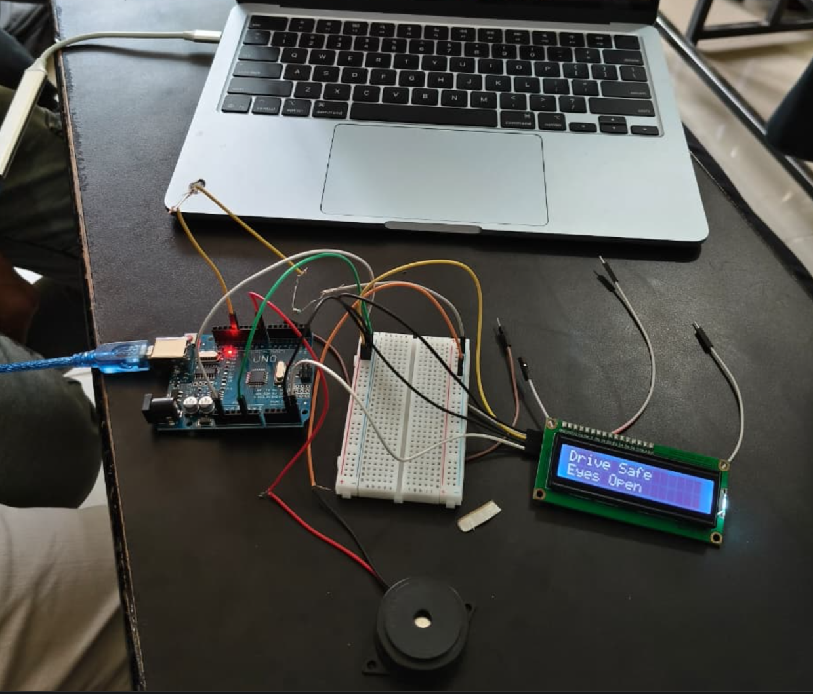

# 🚗 Driver Drowsiness Detection System

A Python and Arduino-based Driver Drowsiness Detection System that uses computer vision to monitor a driver's eye movements and identify signs of drowsiness.

## 📌 About the Project

Drowsy driving can lead to road accidents. This project aims to detect signs of driver fatigue using a webcam and computer vision techniques.

When drowsiness is detected, the system sends a signal to an Arduino Uno, which activates an alert using a buzzer and displays a warning message on an LCD.

## 🎯 Objectives

- Detect signs of driver drowsiness in real time.
- Monitor eye movements using a webcam.
- Generate an alert when drowsiness is detected.
- Integrate Python with Arduino hardware.

## 🛠️ Technologies Used

- **Python** – Main programming language
- **OpenCV** – Image processing and computer vision
- **Dlib** – Facial landmark detection
- **NumPy** – Numerical operations
- **Arduino Uno** – Hardware control
- **C/C++** – Arduino programming

## 🔧 Hardware Components

- Arduino Uno
- Webcam
- 16×2 LCD display
- Buzzer
- LED
- Breadboard and connecting wires

## ⚙️ Working Principle

1. The webcam captures the driver's face.
2. Python processes the video frames.
3. Facial landmarks are used to monitor eye movements.
4. The system identifies signs of drowsiness based on eye closure.
5. A signal is sent to the Arduino through serial communication.
6. The Arduino activates the buzzer and displays a warning message.

## 🔌 Arduino Connections

| Component | Arduino Pin |
|---|---|
| LCD RS | D2 |
| LCD EN | D3 |
| LCD D4 | D4 |
| LCD D5 | D5 |
| LCD D6 | D6 |
| LCD D7 | D7 |
| Buzzer | D8 |
| LED | D13 |

*Note: These LCD connections are for a 16×2 parallel LCD.*

## 📁 Project Files

- `Driver_Sleep_Detection_System_Arduino.ino` – Arduino program
- `drowsiness_detector_python.py` – Python program
- `README.md` – Project documentation

- ## 📸 Project Setup

## 👨‍💻 Developer

**Md Ghaziuddin Amaan**  
Computer Science Engineering Student

